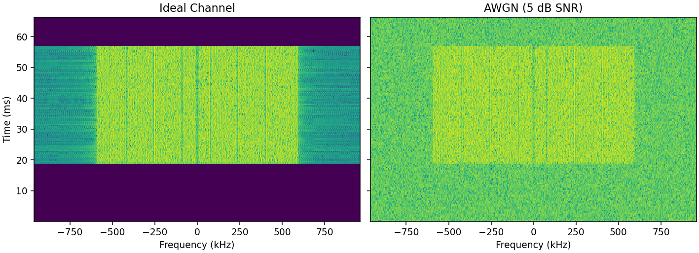
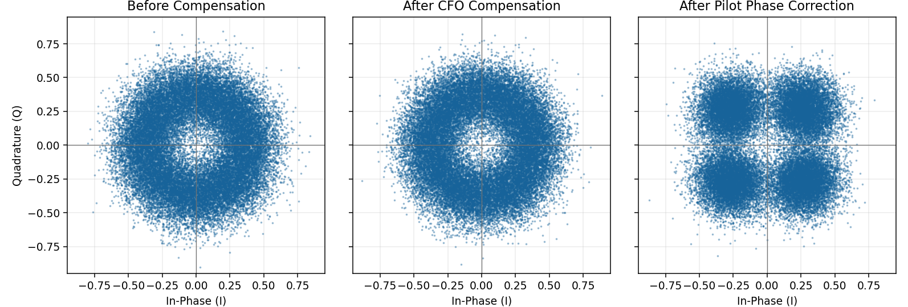

# OFDM Simulation

Simulation of an OFDM transmitter and receiver using Python and Jupyter Notebook.

The project demonstrates OFDM signal generation, transmission through different channel conditions, receiver synchronization, and demodulation.

## View Online

[](https://github.com/nomatin/OFDM-Phy-Simulation/blob/main/ofdm.ipynb)
[](https://nbviewer.org/github/nomatin/OFDM-Phy-Simulation/blob/main/ofdm.ipynb)

## Run Online

[](https://mybinder.org/v2/gh/nomatin/OFDM-Phy-Simulation/90d7493a43e42e7a938c4861643cfee602563726?urlpath=lab%2Ftree%2Fofdm.ipynb)

## Features

- OFDM modulation and demodulation
- Configurable OFDM parameters
- Data and pilot subcarrier allocation
- Cyclic prefix insertion and synchronization
- AWGN and carrier frequency offset (CFO) simulation
- CFO estimation and compensation
- Pilot-based phase correction
- Bit Error Rate (BER) analysis
- Signal spectrum, spectrogram, and constellation visualization

## Run Locally

From the repository root, use Python 3.11 or later to install the dependencies and open the notebook.

```bash
python -m pip install -r requirements.txt
python -m jupyterlab ofdm.ipynb
```

Set the simulation parameters in **OFDM, Modulation, and Channel Constants**, then run all cells from a fresh kernel.

## Simulation Results

### Effect of Additive Noise



Both spectrograms use the same power scale. The AWGN case uses 5 dB SNR and shows the noise floor around the OFDM burst.

### CFO and Pilot Phase Correction



The channel applies AWGN at 5 dB SNR and a carrier frequency offset of 960 Hz. The receiver estimates CFO from the cyclic prefix and compensates the phase drift within each symbol. It then uses the pilots to align the constellation across symbols.
